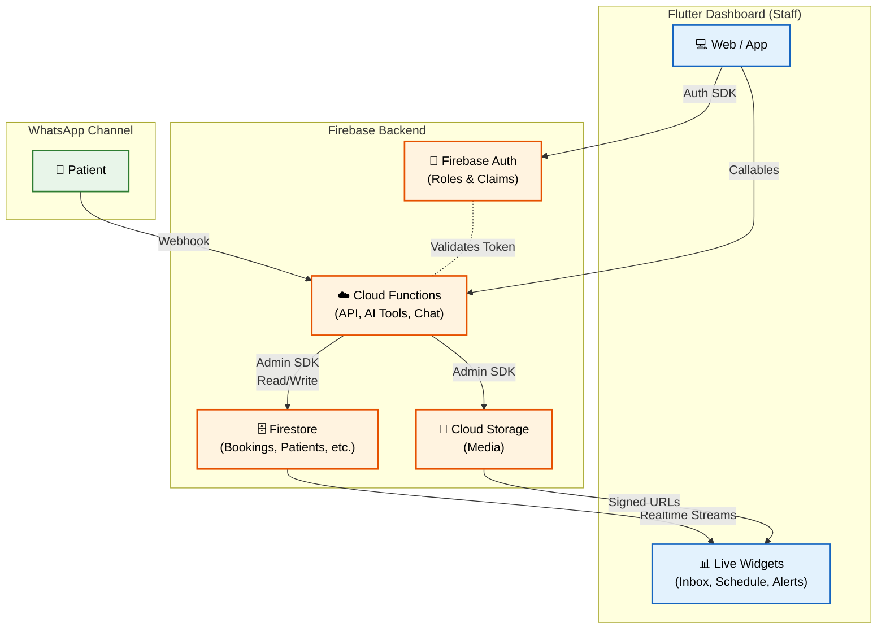

# ARCHITECTURE.md — Cardiology Clinic Management Ecosystem

A comprehensive architecture overview for a staff dashboard (Flutter/Web) plus WhatsApp/AI integration, backed by Firebase (Cloud Functions, Firestore, Auth, Storage, Hosting).

---

## 1. 🔄 End-to-End Data Flow



---

## 2. 💻 Frontend Path: Staff ↔ Dashboard ↔ Firebase

1. **Authentication**: A staff member logs in via `features/auth` → `AuthRemoteDataSource` (Firebase Auth). The role (`physician` / `leadAssistant` / `staffAssistant`) is derived from the **custom claims** in the ID-token — not stored locally.
2. **Requests**: Screens consume `usecases` → `repositories` → `remote data sources` that call **Callable Cloud Functions** and/or read/write **Firestore** directly.
3. **Live streams**: The dashboard, schedule, and inbox subscribe to a `Stream` of Firestore snapshots, so the UI updates in real time on any backend change.
4. **Caching**: Sensitive data (PHI/PII) is stored in encrypted Hive for offline operation and purged on logout.

---

## 3. 💬 WhatsApp + AI Channel

- **Entry point**: A patient message on WhatsApp → **WhatsApp Business Cloud API** → **webhook** (Cloud Function).
- **Agent (Orchestrator)**: `ai/orchestrator.ts` classifies intent, manages the conversation via a state machine (booking-flow / cancel-flow), and generates the reply.
- **AI tools (Function Calling)**: The agent is **only permitted** to act through specific registered tools:

| Tool | Purpose |
|------|---------|
| `check_availability` | Query available appointment slots |
| `create_booking` | Book an appointment |
| `cancel_booking` | Cancel an existing booking |
| `join_waitlist` | Register the patient on the waitlist |
| `answer_faq` | Answer common clinic questions (prevents hallucination) |
| `offer_mtm_consultation` | Offer a medication-therapy consultation |
| `escalate_to_staff` | Escalate the conversation to a human staff member |
| `trigger_emergency_protocol` | Critical emergency protocol |

- **Output to Dashboard**: Booking/action results are written to Firestore → they appear in the **Unified Inbox**, **AI Assistant Actions**, and **Emergency Alerts** via live Firestore streams.

---

## 4. 🌍 Environments

Three separate Firebase projects (each with its own independent database):

| Environment | Usage |
|-------------|-------|
| Dev | Daily development |
| Staging | Pre-production testing |
| Prod | Live version for clinic staff |

- **Frontend**: The project is selected at compile time via `--dart-define=FLAVOR=dev|staging|prod`.
- **Backend**: Switched via Firebase project aliases.

---

## 5. 📁 Repository Layout

```
Repo Root/
├── dashboard/                 # Flutter staff dashboard
│   ├── lib/                   # Code (core/ + features/)
│   ├── firebase.json          # Hosting config
│   └── pubspec.yaml
├── backend/                   # Firebase Functions + Firestore + Storage
│   ├── functions/src/         # ai/*, api/*, bookings/*, conversations/* ...
│   ├── firebase.json          # Functions/Rules/Emulators config
│   ├── firestore.rules
│   ├── storage.rules
│   └── .firebaserc            # Project aliases
├── ARCHITECTURE.md            # This file
└── README.md
```

> The Hosting config (`firebase.json`) lives in `dashboard/`; Functions/Firestore/Storage configuration lives in `backend/`.
