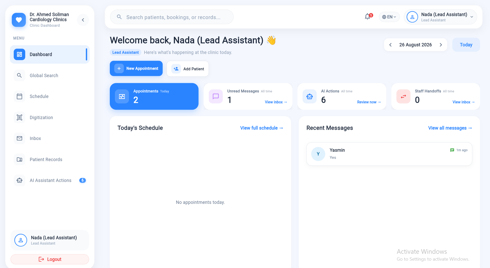
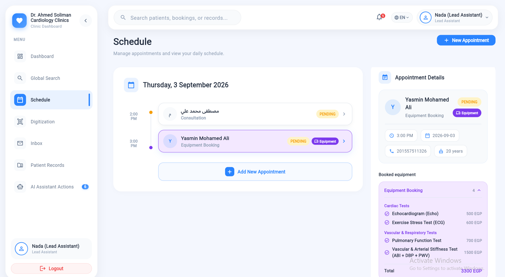
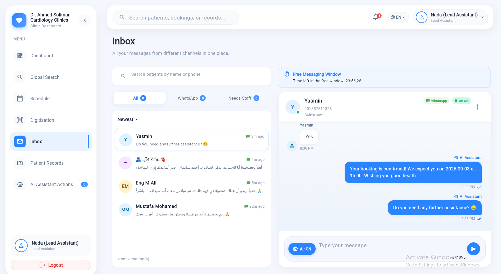
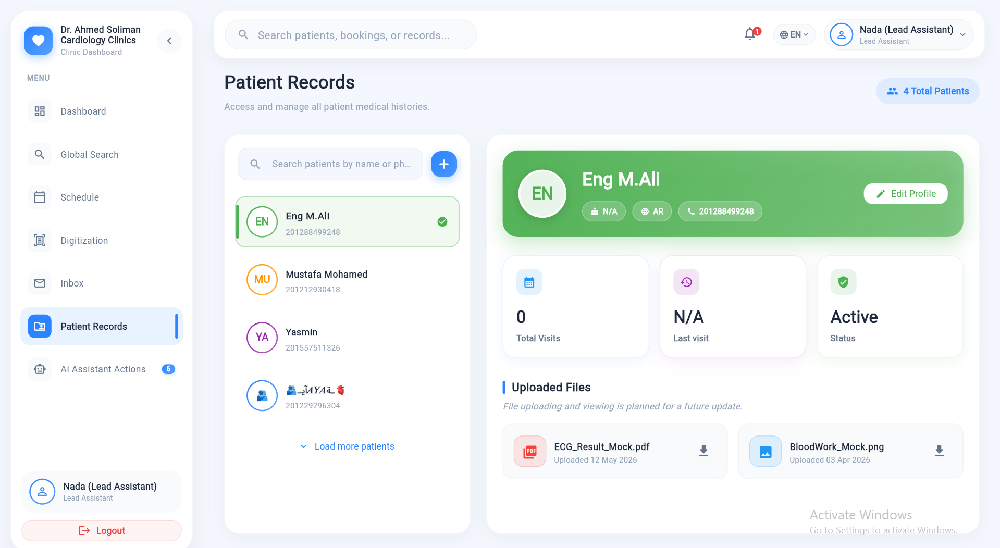
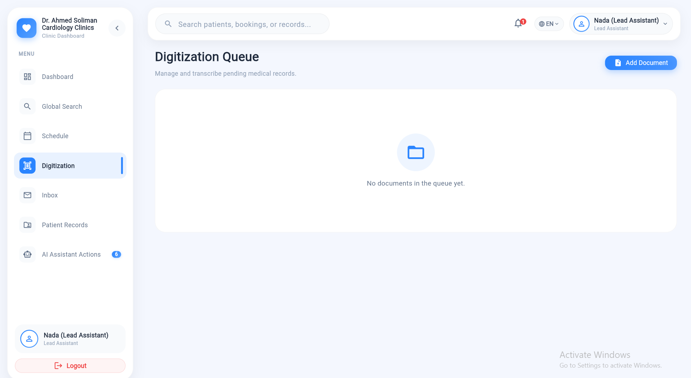
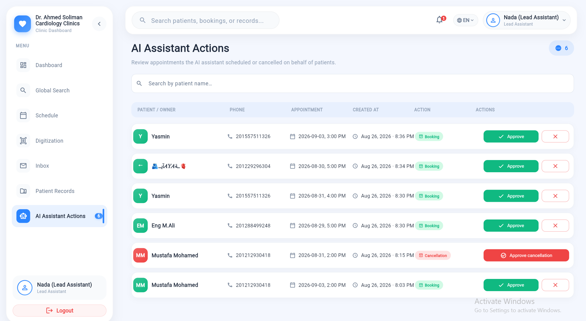
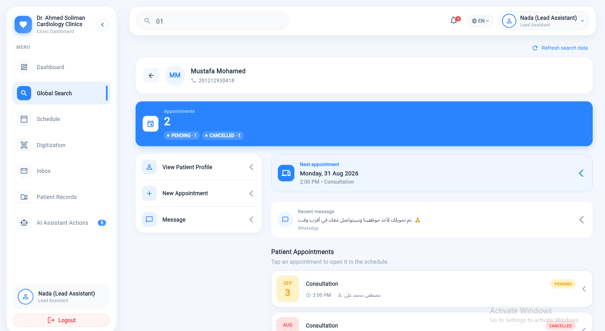

# Dr. Ahmed Soliman Cardiology Clinics — Public Showcase

  

  
  
  
  
  

> A **code showcase** demonstrating the architecture patterns used in the Dr. Ahmed Soliman Cardiology Clinics Ecosystem — a full-stack clinic management system powered by Flutter + Firebase Cloud Functions + Gemini AI.

---

## 📁 What Is in This Folder

| File | Description |
|------|-------------|
| `README.md` | This file — project overview |
| `CLEAN_ARCHITECTURE.md` | Clean Architecture deep-dive with real code examples |
| `WHATSAPP_FIREBASE_GEMINI.md` | How the WhatsApp webhook connects to Firebase + Gemini AI |
| `ARCHITECTURE.md` | End-to-end system architecture (sanitized) |
| `SECURITY.md` | Security model overview |

---

## 🌟 System Overview

A fully integrated **cardiology clinic management ecosystem** that unifies:

- **Staff Dashboard** — a Flutter (web) app for physician and clinic assistants.
  Schedule, unified inbox, bookings, digitization, patient records, AI assistant actions, emergency alerts, staff management.

- **WhatsApp AI Agent** — patients message the clinic on WhatsApp; a Gemini-powered LLM agent handles booking, waitlisting, FAQs, and emergency escalation automatically in Arabic and English.

---

## 🛠️ Tech Stack

| Layer | Technology |
|-------|-----------|
| Frontend | Flutter 3.x / Dart, BLoC/Cubit, injectable + get_it |
| Backend | Firebase Cloud Functions Gen 2 (TypeScript) |
| Database | Cloud Firestore |
| AI | Google Gemini with function-calling tools |
| Messaging | Meta WhatsApp Business Cloud API |
| Auth | Firebase Authentication (custom role claims) |
| Storage | Firebase Cloud Storage (PHI-gated signed URLs) |

---

## ✨ Key Features

### Staff Dashboard
- 📊 Live KPI overview
- 🗓️ Daily schedule with conflict detection
- 💬 Unified WhatsApp inbox (real-time Firestore streams)
- 📅 Booking management (create / reschedule / cancel)
- 🤖 AI assistant action review panel
- 🚨 Emergency alert system
- 🔎 Global search across patients, bookings, conversations

### WhatsApp AI Agent
- Conversational booking / cancellation / waitlist (Arabic + English)
- Guardrailed FAQ answers (no hallucinated services or prices)
- Automatic emergency detection → staff red alert + ER redirect
- Human handoff: AI pauses when a staff member replies
- Webhook signature validation (HMAC-SHA256)
- Voice note transcription (Gemini audio)

---

## 📸 Screenshots

### Dashboard & Schedule

| Dashboard | Schedule |
|-----------|---------|
|  |  |

### Unified Inbox

### Patient Records & Digitization

| Patient Records | Digitization |
|----------------|-------------|
|  |  |

### AI Assistant Actions & Global Search

| AI Assistant Actions | Global Search |
|---------------------|--------------|
|  |  |

---

## 📐 Architecture Patterns

See `CLEAN_ARCHITECTURE.md` for full code examples of:

1. **Inbox Feature** — Flutter Clean Architecture (Entity → UseCase → Repository → DataSource → Cubit)
2. **AI Orchestrator** — Backend pipeline pattern (multi-step coordinator with single-responsibility modules)

See `WHATSAPP_FIREBASE_GEMINI.md` for:

- WhatsApp webhook setup and signature verification
- Inbound message pipeline flow
- Gemini function-calling integration
- Firestore write-back pattern

---

## 📝 Note

This showcase contains **no production credentials, no patient data, no API keys, and no Firebase project IDs**.
All secrets are managed via Firebase Secret Manager.
